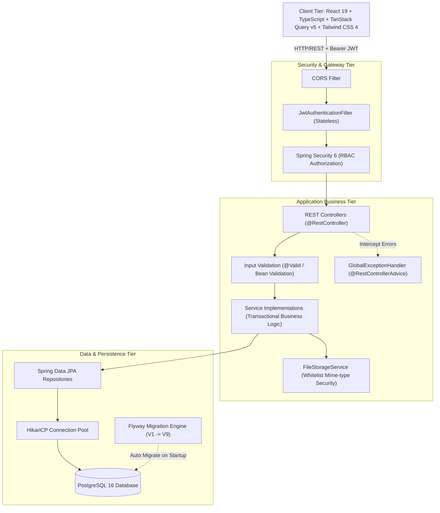

<p align="center">
  <h1 align="center">🎓 EduCore LMS - Enterprise Learning Management System</h1>
  <p align="center">
    <strong>Hệ thống Quản lý Đào tạo & Học tập Trực tuyến Chuẩn Doanh nghiệp</strong>
  </p>
  <p align="center">
    Xây dựng trên nền tảng <b>Spring Boot 3 (Java 21)</b>, <b>PostgreSQL 16</b>, <b>React 19</b> và <b>TypeScript</b>.
  </p>
</p>

<p align="center">
  
  
  
  
  
  
  
  
</p>

---

## 📌 Giới thiệu dự án (Overview)

**EduCore LMS** là nền tảng quản lý học tập và đào tạo trực tuyến (E-Learning) hoàn chỉnh, giải quyết trọn vẹn quy trình giáo dục hiện đại giữa **Nhà quản trị (Admin)**, **Giảng viên (Instructor)** và **Học viên (Student)**.

Dự án được thiết kế theo tư duy kiến trúc phân tầng chuẩn doanh nghiệp (Layered Enterprise Architecture), áp dụng triệt để các kỹ thuật lập trình backend mạnh mẽ kết hợp cùng trải nghiệm người dùng hiện đại, trực quan (Modern Full-screen Learning Workspace phong cách Coursera & Udemy).

---

## 🚀 Tính năng nổi bật theo vai trò (Role-Based Features)

### 1. 🛡️ Quản trị viên hệ thống (ADMIN)
- **Quản lý người dùng đa vai trò (RBAC):** Cấp phát tài khoản, phân quyền Giảng viên/Học sinh, quản lý trạng thái kích hoạt tài khoản.
- **Quản lý danh mục khóa học (Category Taxonomy):** Tổ chức chuyên ngành, bộ môn đào tạo theo sơ đồ phân cấp.
- **Thống kê tổng quan:** Theo dõi số lượng người dùng, khóa học và lớp học toàn hệ thống.

### 2. 👨‍🏫 Giảng viên (INSTRUCTOR)
- **Thiết kế khóa học linh hoạt:** Cấu trúc khóa học nhiều tầng `Khóa học (Course) -> Chương (Chapter) -> Bài học (Lesson)`.
- **Nhân bản khóa học (Course Cloning):** Sao chép nguyên vẹn cây khóa học, chương, bài học, bài tập và câu hỏi trắc nghiệm sang một bản nháp mới chỉ với một thao tác.
- **Hỗ trợ đa định dạng học tập:**
  - Video bài giảng trực quan (nhúng YouTube hoặc video tải lên).
  - Tài liệu bài đọc định dạng PDF (tích hợp trình đọc PDF tương tác trực tiếp, hỗ trợ toàn màn hình).
  - Bài đọc văn bản lý thuyết (Rich lecture notes).
- **Ngân hàng bài kiểm tra trắc nghiệm (Quiz Engine):**
  - Tạo đề kiểm tra trắc nghiệm theo bài học, thiết lập thời gian làm bài, điểm qua môn.
  - Tự động thống kê số lượt làm bài, phổ điểm, tỷ lệ đạt/trượt của từng lớp.
- **Quản lý & Chấm bài tập thực hành (Assignment):**
  - Thiết lập deadline, yêu cầu nộp file bài làm.
  - Chấm điểm số, để lại nhận xét chi tiết cho từng sinh viên.
- **Quản lý lớp học & Học viên:** Mở lớp học theo khóa, duyệt/ghi danh học viên, xem **Sổ điểm lớp học (Gradebook)** tổng hợp toàn diện.

### 3. 🎓 Học sinh / Sinh viên (STUDENT)
- **Lộ trình học tập tuần tự (Sequential Progression):** Cơ chế khóa/mở bài học thông minh — học viên phải hoàn thành bài trước mới được mở bài tiếp theo.
- **Không gian học tập chuyên biệt (Learning Workspace):**
  - Trải nghiệm toàn màn hình (Full-screen Distraction-free) chuẩn Coursera / Udemy.
  - Tích hợp 3 phân hệ: *Tài liệu bài học*, *Bài thi trắc nghiệm (Quiz)*, *Khu vực nộp file bài tập (Assignment)*.
  - Ngăn kéo lộ trình (Curriculum Drawer) tra cứu tiến độ học tức thì.
- **Hệ thống làm Quiz & Xem lại đáp án chi tiết:**
  - Đếm ngược thời gian làm bài, tự động nộp khi hết giờ.
  - Hệ thống tự động chấm điểm và phản hồi kết quả ngay lập tức.
  - **Màn hình xem lại bài thi:** Hiển thị rõ câu đúng, câu sai, đáp án chính xác và lời giải thích chi tiết.
- **Bảng điểm cá nhân (My Grades):** Theo dõi chi tiết điểm số của từng bài Quiz và Assignment trong suốt khóa học.

---

## 🏗️ Kiến trúc hệ thống (System Architecture)



---

## 💎 Điểm sáng kỹ thuật (Technical Highlights)

1. **Quản lý CSDL chuyên nghiệp với Flyway:**
   - Phiên bản hóa cấu trúc cơ sở dữ liệu qua các script di chuyển từ `V1` đến `V9`.
   - Tuyệt đối không dùng `hibernate.ddl-auto: update`, đảm bảo toàn vẹn dữ liệu trong môi trường Production.
   - Bổ sung Audit Timestamps (`created_at`, `updated_at`) tự động kích hoạt qua `@PrePersist` / `@PreUpdate` trên mọi thực thể chính.
2. **Bảo mật đa tầng & An toàn tải tệp (File Security Whitelist):**
   - Kiểm tra chặt chẽ cả phần mở rộng (extension) và MIME-type thực tế của file tải lên (`application/pdf`, `image/png`, `application/zip`...). Chặn đứng nguy cơ upload mã độc thực thi (`.exe`, `.sh`, `.php`, `.jsp`...).
3. **Stateless JWT Authentication & Phân quyền Method Security:**
   - Token-based Authentication với thời gian sống cấu hình linh hoạt.
   - Phân quyền chi tiết trên từng phương thức thông qua `@PreAuthorize("hasRole('ADMIN')")`.
4. **Chuẩn hóa API & Xử lý ngoại lệ tập trung:**
   - Mọi API trả về đều tuân thủ cấu trúc đồng nhất `ApiResponse<T>` với trạng thái `success`, `message`, `data`.
   - Toàn bộ lỗi được bắt và chuyển đổi mã HTTP chính xác qua `@RestControllerAdvice`.
5. **Hiệu năng & Trải nghiệm Client (Frontend):**
   - Quản trị Server Cache với **TanStack Query v5**: Tối ưu hóa request, tránh tải lại dữ liệu dư thừa, tự động invalidate cache khi tạo/sửa/xóa.
   - Strict TypeScript: 100% Request DTO, Response DTO và Model Entity đều được định kiểu chặt chẽ.

---

## 🛠️ Công nghệ sử dụng (Tech Stack)

| Phân hệ | Công nghệ | Chi tiết sử dụng |
| :--- | :--- | :--- |
| **Backend** | Java 21 LTS | Phiên bản Java hiện đại, hiệu năng cao |
| | Spring Boot 3.3.5 | Framework cốt lõi cho Web REST API |
| | Spring Security 6 | Bảo mật, xác thực & phân quyền RBAC |
| | Spring Data JPA | Tương tác CSDL qua Hibernate ORM |
| | Flyway 10 | Quản lý phiên bản migration cơ sở dữ liệu |
| | JJWT (Java JWT) | Ký và xác thực mã thông báo JSON Web Token |
| | Lombok | Giảm tải boilerplate code (Getters/Setters/Builders) |
| | SpringDoc OpenAPI | Tài liệu hóa API tự động (Swagger UI 3) |
| **Frontend** | React 19 | Thư viện UI xây dựng giao diện ứng dụng thế hệ mới |
| | TypeScript 5.8 | Ngôn ngữ tĩnh an toàn kiểu dữ liệu |
| | Vite 8 | Build tool thế hệ mới với tốc độ bundling cực nhanh |
| | TanStack Query v5 | Quản lý server state, fetching & caching |
| | Tailwind CSS 4.0 | CSS framework hiện đại với Vite plugin (@tailwindcss/vite) |
| | React Router v7 | Định tuyến trang và phân quyền client route |
| | Lucide React | Bộ icon hiện đại, tối giản |
| **Cơ sở dữ liệu** | PostgreSQL 16 | Hệ quản trị cơ sở dữ liệu quan hệ mạnh mẽ |
| **DevOps** | Docker & Compose | Container hóa CSDL & quản lý dịch vụ |

---

## 🚀 Hướng dẫn cài đặt & Khởi chạy (Getting Started)

### Yêu cầu môi trường (Prerequisites)
* **JDK:** Java 21 trở lên
* **Node.js:** Node 18+ & npm
* **Docker & Docker Desktop:** Để chạy PostgreSQL

### Bước 1: Khởi động Cơ sở dữ liệu (PostgreSQL)
Tại thư mục gốc của dự án, khởi động PostgreSQL container:
```bash
docker compose up -d
```
> Database `lmsdb` sẽ tự động khởi tạo trên cổng `localhost:5432` với user `postgres` / mật khẩu `123`.

### Bước 2: Khởi động Backend (Spring Boot)
Mở cửa sổ dòng lệnh (Terminal) mới:
```bash
cd backend
mvn spring-boot:run
```
* Backend sẽ chạy tại: `http://localhost:8080`
* Flyway sẽ tự động kích hoạt và chạy toàn bộ các migration từ `V1` đến `V9` cùng dữ liệu mẫu (Seed Data).
* **Tài liệu Swagger API:** `http://localhost:8080/swagger-ui.html`

### Bước 3: Khởi động Frontend (React)
Mở cửa sổ dòng lệnh thứ hai:
```bash
cd frontend
npm install
npm run dev
```
* Truy cập giao diện ứng dụng tại: **`http://localhost:5173`**

---

## 🔑 Danh sách tài khoản thử nghiệm (Demo Credentials)

> **Mật khẩu chung cho tất cả Giảng viên và Học sinh:** `123456`

| Vai trò (Role) | Họ và tên | Email đăng nhập | Mật khẩu | Quyền hạn chính |
| :--- | :--- | :--- | :---: | :--- |
| **ADMIN** | Administrator | `admin@lms.com` | `admin123` | Quản trị toàn bộ hệ thống |
| **INSTRUCTOR** | ThS. Nguyễn Văn Hùng | `gv.hung@lms.com` | `123456` | Quản lý khóa học & lớp Khoa CNTT |
| **INSTRUCTOR** | TS. Trần Thị Mai | `gv.mai@lms.com` | `123456` | Quản lý khóa học Khoa Phần mềm |
| **STUDENT** | Nguyễn Hoàng Anh | `hs.anh@lms.com` | `123456` | Học viên làm bài, học tập |
| **STUDENT** | Trần Bảo Bình | `hs.binh@lms.com` | `123456` | Học viên làm bài, học tập |

*(Xem thêm danh sách đầy đủ 5 Giảng viên và 20 Học sinh tại [DANH_SACH_TAI_KHOAN.md](DANH_SACH_TAI_KHOAN.md))*

---

## 📂 Cấu trúc thư mục dự án (Project Structure)

```text
duankhoahoc-lophoc/
├── docker-compose.yml              # Khởi tạo PostgreSQL 16
├── DANH_SACH_TAI_KHOAN.md          # Danh sách tài khoản demo
├── backend/
│   ├── pom.xml                     # Maven dependencies (Spring Boot 3, Security, Flyway, JPA)
│   └── src/main/
│       ├── java/com/lms/
│       │   ├── common/             # ApiResponse, PageResponse, Enums
│       │   ├── config/             # SecurityConfig, JwtFilter, DataInitializer
│       │   ├── controller/         # REST Controllers (Auth, Course, Lesson, Quiz, Class...)
│       │   ├── dto/                # Request & Response DTOs
│       │   ├── entity/             # JPA Entities (User, Course, Lesson, Quiz, Submission...)
│       │   ├── exception/          # GlobalExceptionHandler, Custom Exceptions
│       │   ├── repository/         # Spring Data JPA Repositories
│       │   ├── security/           # UserDetails, JwtTokenProvider
│       │   └── service/            # Business Logic Services & Implementations
│       └── resources/
│           ├── application.yml     # Cấu hình Spring Boot, JWT, Database
│           └── db/migration/       # Flyway SQL migrations (V1 -> V9)
└── frontend/
    ├── package.json                # React, TypeScript, Vite, TanStack Query
    ├── src/
    │   ├── api/                    # Axios client & API endpoints
    │   ├── components/             # Reusable UI, Layout, Student & Instructor views
    │   ├── hooks/                  # TanStack Query custom hooks
    │   ├── pages/
    │   │   ├── admin/              # Dashboard, User & Category Management
    │   │   ├── instructor/         # Course, Chapter, Class & Gradebook Management
    │   │   ├── student/            # CourseProgress, LessonWorkspace, Quiz, MyClasses
    │   │   └── common/             # Profile, Login, NotFound
    │   ├── router.tsx              # React Router với ProtectedRoute RBAC
    │   └── types/                  # TypeScript interface/types đồng bộ với backend DTOs
```

---

<p align="center">
  Developed by <b>Candidate for Java / Fullstack Developer Internship</b>
</p>
